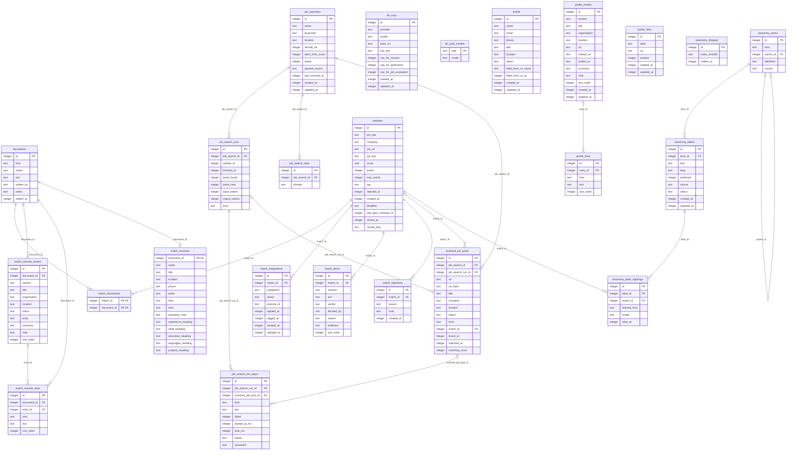

# Database schema

The tables after every migration in `migrations/` (up to `0011_one_user_schema`), as SQLite has them. PK is a primary key, FK a foreign key; a line runs from the table a key points at to the table that has it.

